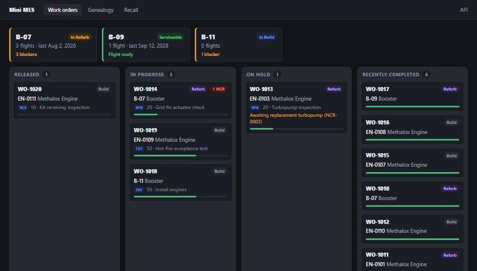
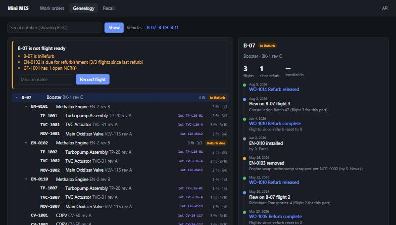
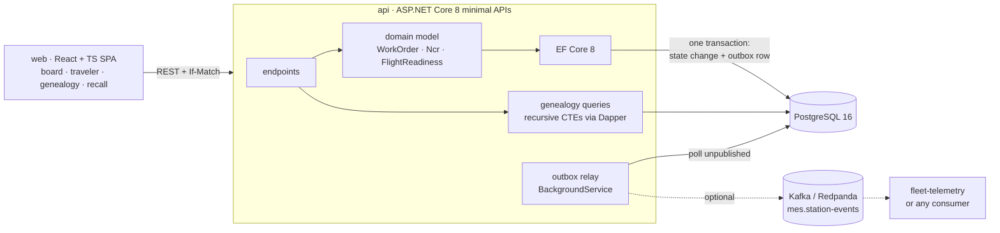
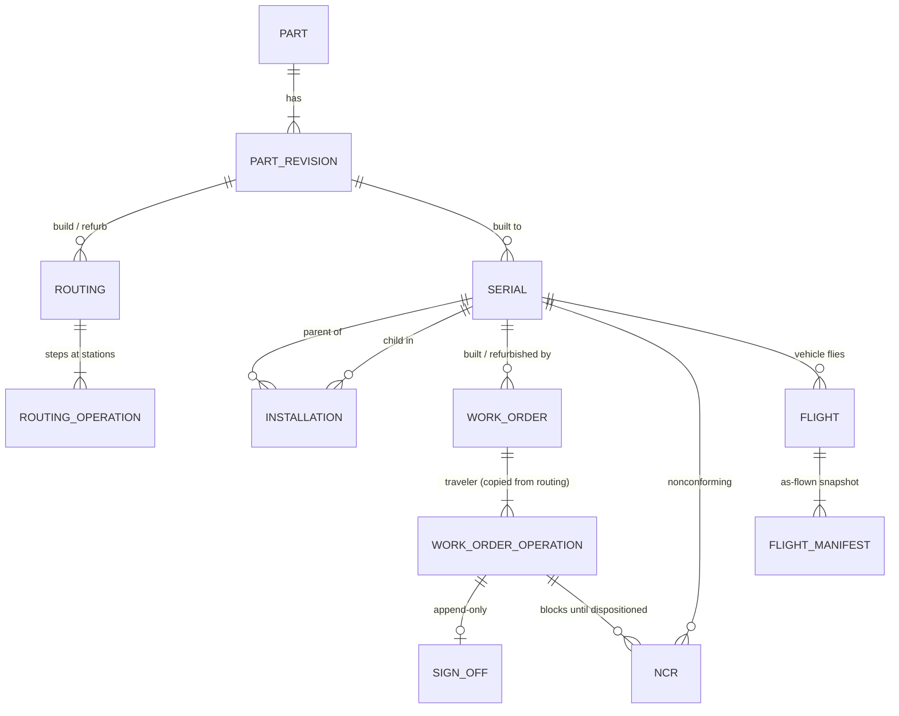

# Mini MES

A small manufacturing execution system for a factory that builds **and re-flies** hardware. It tracks parts and revisions, serialized units, work orders with step-by-step travelers, operation sign-off, nonconformance reports (NCRs), as-built genealogy, and, for reusable vehicles, every flight and refurbishment of every serial.


It is the factory-side companion to [fleet-telemetry](https://github.com/wallaceandrew9331-create/fleet-telemetry), which watches hardware once it is flying. Station events can be published to Kafka so both systems can share a stream.





## What it answers

- **What's on the floor?** A work-order board grouped by status, showing each unit's current operation and station plus open NCRs, with a flight-readiness card per vehicle.
- **What step is this unit on, and who signed off the last one?** The station traveler: sign off in sequence, raise an NCR against the unit or any part installed in it, disposition it as *use-as-is*, *rework* (a rework step is inserted ahead of the blocked operation) or *scrap* (the part is retired and pulled from its parent).
- **What's inside B-07 right now?** The genealogy tree, with each part's flights, flights since its last refurb against its refurb interval, and anything blocking flight.
- **What's the full flight and refurb history of serial X?** One timeline per serial: created, installed and removed, built, flown (with its own flight count), refurbished, NCRs.
- **Which flown vehicles contain a part from lot Y?** The recall query. It reads flight manifests, so it still catches a part that flew and was later swapped out, and it shows where each suspect part is installed now.

## Architecture



| Directory | Stack | Responsibility |
|---|---|---|
| `backend/src/MiniMes.Api` | C# 12, .NET 8, ASP.NET Core minimal APIs, EF Core 8 + Npgsql, Dapper, Confluent.Kafka | Domain model, persistence and migrations, REST API (Swagger at `/swagger`), seed data, outbox relay |
| `backend/tests/MiniMes.Tests` | xUnit, Testcontainers, WebApplicationFactory | Domain unit tests; API integration tests against a real Postgres 16 |
| `web/` | React 18, TypeScript, Vite, React Router | The SPA, served by nginx, which also proxies `/api` |
| `docker-compose.yml` | Postgres 16, optional Redpanda | Runs everything |

### Domain model



## Quick start

Requires Docker.

```bash
docker compose up --build
```

- App: http://localhost:8081
- API + Swagger: http://localhost:5080/swagger
- Postgres: `localhost:5433` (user/password/db `mes`). Port 5432 is left free for fleet-telemetry.

The database is migrated and seeded on first start. To start over from a clean seed:

```bash
docker compose down -v
```

### Things to try

1. **Board:** B-09 is flight-ready. B-07 has three blockers: it's in refurb, EN-0102 has reached its 3-flight refurb interval, and grid fin GF-1001 has an open NCR.
2. **WO-1014** (B-07 refurb): operation 20 is blocked by NCR-0003. Disposition it as *Rework* and a rework step appears ahead of op 20. Open the same traveler in two tabs and sign off in both: the second gets a 412 and reloads.
3. **Genealogy › B-07 › EN-0103 history:** it flew twice, its turbopump was scrapped (NCR-0002), and it was swapped out for EN-0110.
4. **Recall › L26-0412:** B-07 (3 flights) and B-09 (1 flight) flew with parts from this lot. B-11 contains one but hasn't flown, and one spare from the lot is still on the shelf.
5. **Genealogy › B-09 › Record flight**, then look at B-09's flight counts again.

### Publishing station events to Kafka

```bash
KAFKA_BOOTSTRAP_SERVERS=redpanda:9092 docker compose --profile kafka up --build
docker compose exec redpanda rpk topic consume mes.station-events
```

Events (`operation.signed_off`, `ncr.raised`, `ncr.dispositioned`, `part.installed`, `part.removed`, `flight.recorded`) are JSON envelopes `{id, type, occurredAt, data}`, keyed by serial number. To feed fleet-telemetry instead, point `KAFKA_BOOTSTRAP_SERVERS` at its broker.

### Local development

```bash
docker compose up postgres                       # database only, on :5433
cd backend && dotnet run --project src/MiniMes.Api --urls http://localhost:5080
cd web && npm install && npm run dev             # http://localhost:5174, proxies /api to :5080
```

No .NET SDK installed? `backend/dotnet.sh` runs any `dotnet` command in the official SDK container, e.g. `./dotnet.sh test`.

### Tests

```bash
cd backend && dotnet test     # 36 tests: domain unit tests + integration tests on Postgres via Testcontainers
cd web && npm test            # tree building and board grouping
```

The integration tests start the real API in-process (`WebApplicationFactory`) against a throwaway Postgres 16 container, seed it, and cover: genealogy and recall results, history across an engine swap, cycle and double-install rejection, flight readiness and manifests, **two concurrent sign-offs with the same version (exactly one wins)**, NCR rework and scrap flows, the outbox write, and the append-only triggers.

## Design decisions and tradeoffs

### Genealogy: adjacency list and recursive CTEs, not a closure table

`installations(parent_id, child_id, installed_at, removed_at)` stores one row per install. Removing a part sets `removed_at` and never deletes the row. Trees are walked with `WITH RECURSIVE` ([GenealogyQueries.cs](backend/src/MiniMes.Api/Queries/GenealogyQueries.cs)).

- **Why:** writes are the hot path on a factory floor, and here an install or removal is a single-row insert or update. The same table is the full history, so "what was in EN-0103 in May?" needs no extra audit table. Assemblies are shallow (vehicle › engine › component is 3 levels; real ones are maybe 5 to 8), so a recursive query costs a few index lookups per level.
- **Closure table alternative:** it stores every ancestor/descendant pair, so subtree reads become one indexed join, but each install or removal has to insert or delete O(depth × subtree) rows inside a transaction, and keeping it correct over time (history) is much harder. I'd switch if profiling showed tree reads dominating with very deep trees. A middle ground is `ltree` paths or a materialized view refreshed off the write path.
- **Integrity in the database, not just the API:** a partial unique index `ON installations(child_id) WHERE removed_at IS NULL` makes "a part is in at most one parent" impossible to violate, even for a script that bypasses the API. Cycles (installing an engine into its own turbopump) are rejected with an ancestor CTE before insert, because a cycle would make the recursive query run forever.

### Flight manifests: snapshot what flew

Recording a flight copies the vehicle's current tree into `flight_manifest(flight_id, serial_id, parent_serial_id)`. Per-part flight counts and the recall query read manifests, not the live tree. Without the snapshot, swapping EN-0103 out after flight 2 would silently erase its two flights from its history and from any recall. This is deliberate denormalization: the live tree answers "what is installed now", and manifests answer "what flew".

**Refurb interval:** a life-limited part's "flights since refurb" counts manifest flights after its last *completed* refurb work order. Completing the refurb is what resets the count. There's no counter column that could drift from the facts it summarizes.

### Audit trail: sign-offs are immutable

A sign-off records who did what and when, and it has to stay true. `sign_offs`, `flights` and `flight_manifest` are append-only, enforced twice:

1. The `DbContext` rejects any `Modified`/`Deleted` entry for types marked `IAppendOnly` ([MesDbContext.cs](backend/src/MiniMes.Api/Data/MesDbContext.cs)).
2. A `BEFORE UPDATE OR DELETE` trigger raises an error whatever client is connected ([migration](backend/src/MiniMes.Api/Data/Migrations)).

Corrections are new records: an NCR, a rework step, a removal with a reason. Nothing is deleted anywhere: every foreign key is `ON DELETE RESTRICT`. The tradeoff is that data-entry mistakes need a compensating workflow rather than an edit. That's normal for regulated manufacturing, and here it's one more NCR.

### Travelers are copied from routings at release

Releasing a work order copies the routing's operations into `work_order_operations`. Editing a routing, or releasing a new part revision with different steps, never rewrites in-flight or historical travelers, and rework steps can be added to one traveler without touching the template. The cost is duplicated rows, which is cheap.

### Optimistic concurrency on work orders

Two inspectors at one station can open the same traveler. Each work order's version is Postgres' `xmin` system column, mapped as an EF Core row version, so there's no extra column or trigger to maintain. The API sends it as an `ETag`. Writes must send `If-Match` (428 if missing) and are checked twice:

1. **Up front:** if the client's version is stale, return **412** before applying any business rule. A stale client gets "reload", not a confusing "already signed off".
2. **At save:** EF issues `UPDATE ... WHERE id = @id AND xmin = @loaded`. If someone committed in between, no row matches, and the response is also 412.

Every state change, including raising an NCR on the traveler, touches the work order row so `xmin` moves. Otherwise a sign-off could race past a just-raised NCR. The integration tests flushed out one subtle bug here: loading the traveler with `AsSplitQuery()` read the version and the operations in separate statements, so a concurrent commit in between produced an old version with already-completed operations. The load is now a single statement, which gives one consistent snapshot.

**Pessimistic locking alternative:** `SELECT ... FOR UPDATE` would hold row locks while a technician thinks. Optimistic concurrency suits low-contention, human-paced edits.

### Station events: transactional outbox, at-least-once

Each state change inserts an `outbox` row in the same transaction. A `BackgroundService` publishes unpublished rows to Kafka in id order and marks them published only after the broker acks ([OutboxRelay.cs](backend/src/MiniMes.Api/Events/OutboxRelay.cs)).

- **No dual write:** an event exists if and only if its change committed. Publishing directly from the endpoint could commit without publishing, or publish without committing.
- **At-least-once:** a crash between ack and mark re-sends, so consumers dedupe on `id`. Keying by serial keeps one unit's events ordered within a partition.
- **Single relay assumed:** with several API replicas the batch select needs `FOR UPDATE SKIP LOCKED`, or the relay moves to its own process. Postgres logical decoding (Debezium) is the heavier alternative.
- Kafka is optional. Without a broker, events still accumulate and are readable at `/api/events`.

### Smaller choices

- **Domain logic in entities, not services:** `WorkOrder.SignOff`, `Ncr.ApplyDisposition` and `FlightReadiness.Check` are plain methods with private setters, so the rules are unit-tested with no database.
- **EF Core for writes, SQL for recursive reads:** recursive CTEs are clearer as SQL, and Dapper runs them on EF's connection and transaction.
- **Enums stored as text, snake_case naming:** readable in psql and in hand-written SQL, and safe to reorder.
- **Document numbers from Postgres sequences:** `WO-1001` and `NCR-0001` are never duplicated under concurrency. Gaps are acceptable.
- **Migrate on startup:** keeps `docker compose up` to one step. A production deployment would run migrations as a separate release step, and the seed would be off.
- **`TimeProvider` injection:** endpoints never call `DateTime.Now`, so time is controllable in tests and in the seeder.

## Seed data

[FactorySeeder.cs](backend/src/MiniMes.Api/Data/FactorySeeder.cs) builds ten months of history for a small booster factory: 3 boosters, 11 engines, and around 70 serials across 7 stations and 4 routings. It goes through the same domain methods and services as the API, so the seed also exercises the rules. A historical flight that broke flight readiness would fail the seed.

## Not built (yet)

Authentication and roles (the signer is a free-text name; real sign-off would need authenticated identity and possibly e-signatures), part-number BOMs and kitting, inventory locations, time-and-labor capture, and test-data attachments on operations.
